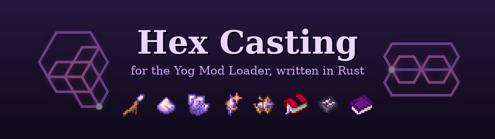
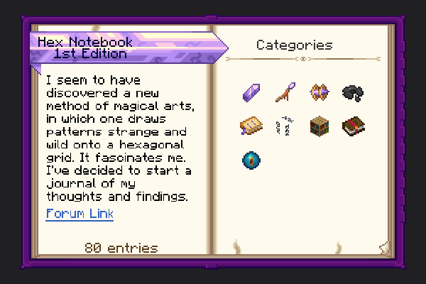
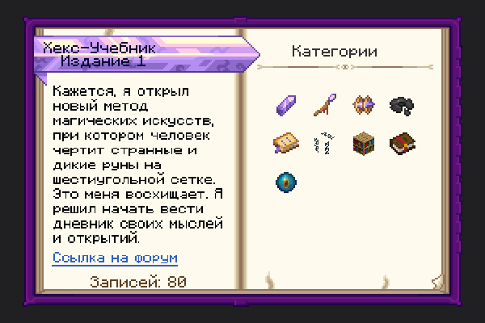
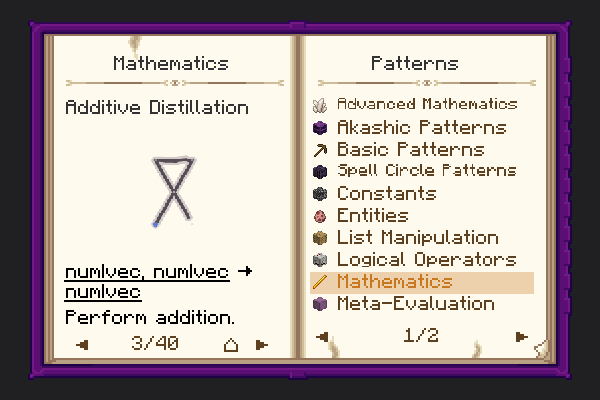
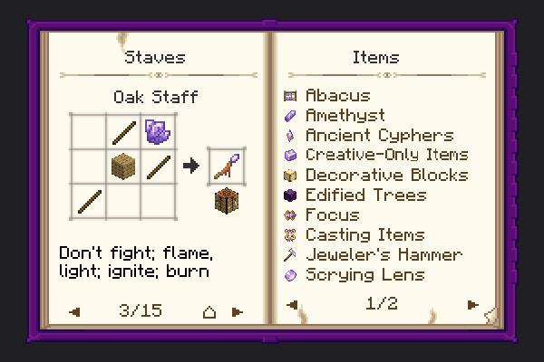
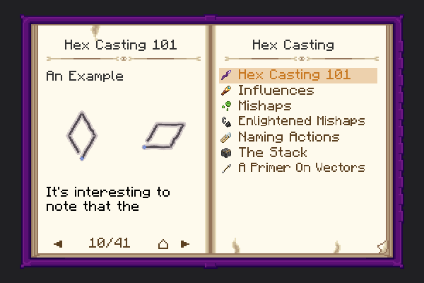
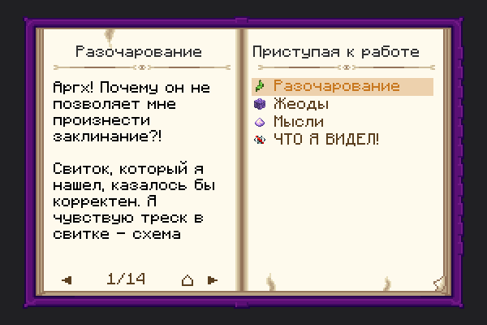

<div align="center">

<a id="top"></a>



# 🔮 HexMod-Yog

### Hex Casting, Ported to Rust on the Yog Mod Loader

[](https://github.com/F000NKKK/Yog-Mod-Loader)
[](https://github.com/FallingColors/HexMod)
[](LICENSE)
[](https://www.rust-lang.org/)


🇺🇸 **English** | 🇷🇺 [Русский](README.ru.md)

[Overview](#-overview) • [Features](#-key-features) • [The Hex Notebook](#-the-hex-notebook) • [Patterns](#-patterns) • [Examples](#-examples) • [Installation](#-installation) • [Building](#-building) • [Status](#-status) • [Credits](#-credits)

</div>

---

## 📖 Overview

**HexMod-Yog** is an unofficial Rust port of
[Hex Casting](https://github.com/FallingColors/HexMod), the Minecraft mod
about programmable magic: you draw patterns on a hex grid, and each pattern
runs one instruction on a stack. Hexes can read the world, do math on
vectors and lists, build and run other hexes, and cast spells that move,
break, conjure and transform things.

The port runs on the [Yog Mod Loader](https://github.com/F000NKKK/Yog-Mod-Loader).
One `.yog` file works on Fabric, Forge and NeoForge, for Minecraft 1.20.1 and
1.21.1. The casting VM, the iota types, every action and the casting grid
are written from scratch in Rust, and follow the original's behaviour,
media costs, mishaps and pattern signatures.

> **This is not the official Hex Casting mod.** It is not affiliated with,
> endorsed by, or supported by its authors or the FallingColors
> organization. For the real, feature-complete mod, get it from
> [Modrinth](https://modrinth.com/mod/hex-casting) or
> [CurseForge](https://www.curseforge.com/minecraft/mc-mods/hexcasting).

## 🌟 Key Features

### 🧠 The Casting VM

- **Faithful evaluation**: the stack, the ravenmind, Introspection and
  Retrospection, Hermes' and Thoth's Gambits, Charon's Gambit and nested
  escapes behave like the original's `CastingVM`.
- **All iota types**: numbers, vectors, booleans, null, Garbage, entities,
  patterns, lists, and the hidden iotas used by meta-evaluation.
- **Media cost model**: dust, shards and charged crystals are spent from the
  inventory in the original's order. Overcasting drains health.
- **Mishaps**: every mishap from the original, with the same messages, the
  coloured sparks and side effects (Garbage pushed, items dropped, the
  caster hurt or blinded).

### ✨ Patterns and Spells

- **186 registered patterns** plus Numerical Reflection and Bookkeeper's
  Gambit, using the original signatures and starting directions.
- **Spells**: Explosion, Fireball, Impulse, Blink, Break Block, Place
  Block, Create Water, Destroy Liquid, Ignite, Extinguish, Conjure Block and
  Light, Overgrow, Edify Sapling, Make Note, Internalize Pigment, Potions,
  Sentinels, Flight, Recharge Item, Erase Item, and Cypher, Trinket and
  Artifact crafting.
- **Great Spells**: Summon Lightning, Greater Teleport, Altiora, Create
  Lava, Summon Rain and Dispel Rain, Flay Mind, Greater Sentinel, the
  greater potions, and Craft Phial.
- **Akashic Library**: Akashic Records with bookshelves and ligatures,
  read and written with Akasha's Distillation and Gambit.

### 🎒 Items and Blocks

- **Staves** of every wood type. The casting grid looks like the original's.
- **Iota storage**: Focus, Spellbook, Scroll and Slate.
- **Media items**: Amethyst Dust, Amethyst Shard, Charged Amethyst and
  Phials.
- **Casting items**: Cypher, Trinket and Artifact.
- **Other items**: pigments, the Thought-Knot, and the Hex Notebook with its
  pages.
- **Blocks**: slate, amethyst, edified wood, scroll paper and quenched
  allay families, plus conjured blocks.
- **Localized**: English and Russian, for every item, pattern, mishap and
  book page.

### ⚙️ Built on Yog

- **One file, six targets**: a single `.yog` loads on Fabric, Forge and
  NeoForge for 1.20.1 and 1.21.1.
- **Native code**: the mod is a Rust `cdylib` built for Linux, Windows and
  macOS. It runs in-process with no JVM bytecode of its own.
- **Generic loader APIs only**: everything Hex Casting needed from the
  game was added to Yog as general-purpose API (action bar text, fluids,
  feature placement, entity tags…). Hex Casting–specific logic stays in the
  mod.

## 📕 The Hex Notebook

The original's guide book, whole: every category, entry and page of Hex
Casting's Patchouli book, in English and Russian. It is a Yog guide book
(`content/thehexbook.ybook`, texts in `resources/Book*.yres`) drawn by
Yog's own book renderer, with Patchouli's look: the original's book
texture, crafting grids with 3D blocks, spotlights, entities, and every
pattern drawn as Hex Casting draws it.

<div align="center">

| | |
|:---:|:---:|
|  |  |
| The landing page | …and in Russian |
|  |  |
| A pattern, its stack effect and description | A recipe with the original's crafting grid |
|  |  |
| Several patterns on one page | Coloured terms and links |

</div>

## 🌀 Patterns

A few of the patterns, drawn from their signatures. The white dot marks
the starting point.

| Pattern | Name | Signature | What it does |
|:---:|---|---|---|
|  | Mind's Reflection | `NE qaq` | Pushes the caster |
|  | Compass' Purification | `E aa` | Entity → eye position |
|  | Alidade's Purification | `E wa` | Entity → look vector |
|  | Archer's Distillation | `E wqaawdd` | Ray → block hit |
|  | Additive Distillation | `NE waaw` | Adds numbers, vectors or lists |
|  | Reveal | `NE de` | Shows the top iota in chat |
|  | Explosion | `E aawaawaa` | Explosion at a position |
|  | Blink | `SW awqqqwaq` | Short-range teleport |
|  | Impulse | `SW awqqqwaqw` | Pushes an entity |
|  | Summon Sentinel | `E waeawae` | Places your sentinel |
|  | Craft Cypher | `E waqqqqq` | Stores a hex in a cypher |
|  | Akasha's Distillation | `W qqqwqqqqqaq` | Reads an Akashic Record |
|  | Anchorite's Flight | `SW awawaawq` | Flight within a radius |
|  | Summon Lightning | `E waadwawdaaweewq` | Great spell |
|  | Greater Teleport | `E wwwqqqwwwqqeqqwwwqqwqqdqqqqqdqq` | Great spell |
|  | Flay Mind | `NE qeqwqwqwqwqeqaeqeaqeqaeqaqded` | Great spell |

As in the original, each world draws every great spell in its own
variant of the shape shown above. The variant is picked from a per-world
seed.

## 📚 Examples

### Reveal what you are looking at

```text
Mind's Reflection        → [you]
Compass' Purification    → [eye position]
Mind's Reflection        → [eye position, you]
Alidade's Purification   → [eye position, look vector]
Archer's Distillation    → [block position]
Reveal                   → prints the block position in chat
```

### Blink forward eight blocks

```text
Mind's Reflection        → [you]
Numerical Reflection 8   → [you, 8]
Blink                    → teleports you 8 blocks along your look
```

### Keep a hex for later

Hold an empty Cypher in your other hand and drop some amethyst on the
ground. Push the dropped item (for example with Entity Purification), then
the hex as a list (Introspection … Retrospection), and cast **Craft
Cypher**. The amethyst becomes the Cypher's media. Using the Cypher then
casts the stored hex.

## 📦 Installation

1. Install the [Yog Mod Loader](https://github.com/F000NKKK/Yog-Mod-Loader)
   for your loader (Fabric, Forge or NeoForge) and Minecraft version
   (1.20.1 or 1.21.1).
2. Drop `HexMod-Yog.yog` into `<game dir>/yog-mods/`.
3. Start the game. New players receive the Hex Notebook and an Oak Staff.

## 🔧 Building

You need the `yog` CLI from the Yog Mod Loader repository and a Rust
toolchain. The targets in `rust-toolchain.toml` are installed
automatically.

```bash
git clone https://github.com/F000NKKK/HexMod-Yog.git
cd HexMod-Yog
yog build                               # every platform → artifacts/HexMod-Yog.yog
YOG_TARGETS=linux-x86_64 yog build      # host only, faster
yog run fabric-1.21.1                   # build and launch a dev client (see yog.toml)
```

To build against a local checkout of `yog-api` instead of crates.io, set
`YOG_API_PATH=…/Yog-Mod-Loader/rust/crates/yog-api`. This rewrites
`yog.lock`, so don't commit it.

## 🚧 Status

Active development. Implemented: the VM, all non-circle patterns, every
spell and great spell, media items, iota storage items and the Akashic
Library. Not yet ported:

- **Spell circles** (impetuses, directrices, slates as a circuit). They
  need block-state properties (facing, energized) that the loader can't
  declare yet.
- **Custom potion effects** (Enlarge Grid, Shrink Grid) and **loot
  injection** (scrolls and cyphers in chests). The loader has no API to
  register these yet.
- **Smaller gaps**:
  - Altiora's gliding pose;
  - pigment-coloured conjured blocks;
  - item cooldowns;
  - teleporting passengers;
  - Pehkui interop.

## 🙏 Credits

Hex Casting was created by **gamma-delta** and is maintained by the
**[FallingColors](https://github.com/FallingColors)** organization and its
[contributors](https://github.com/FallingColors/HexMod/graphs/contributors).

The hex pattern names and spell design come from that project, as do the
book text and the textures bundled here. They are used under its MIT
license.

Yog port: **F000NK** and the Yog Team.

## 📄 License

[MIT](LICENSE). The original Hex Casting copyright notice is preserved
there in full.

---

<div align="center">

**[⬆ Back to Top](#top)**

A Yog Mod Loader showcase

</div>
